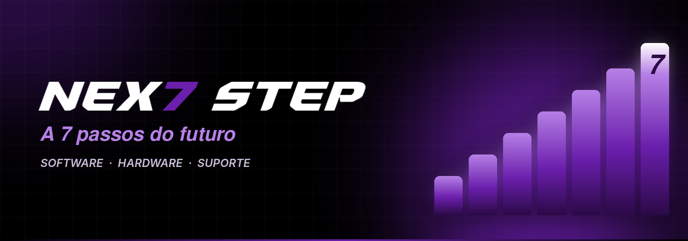
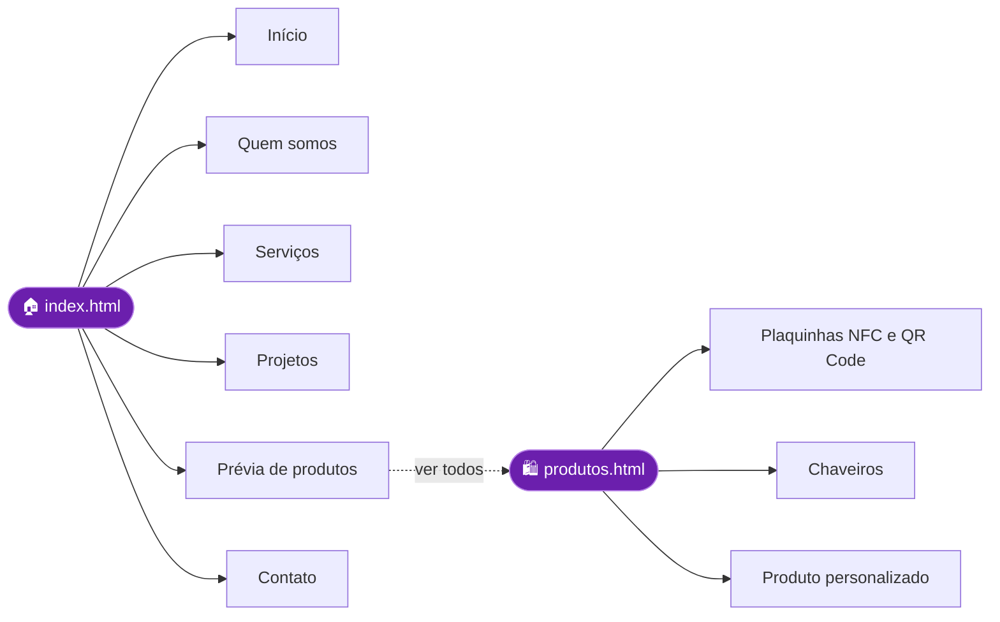
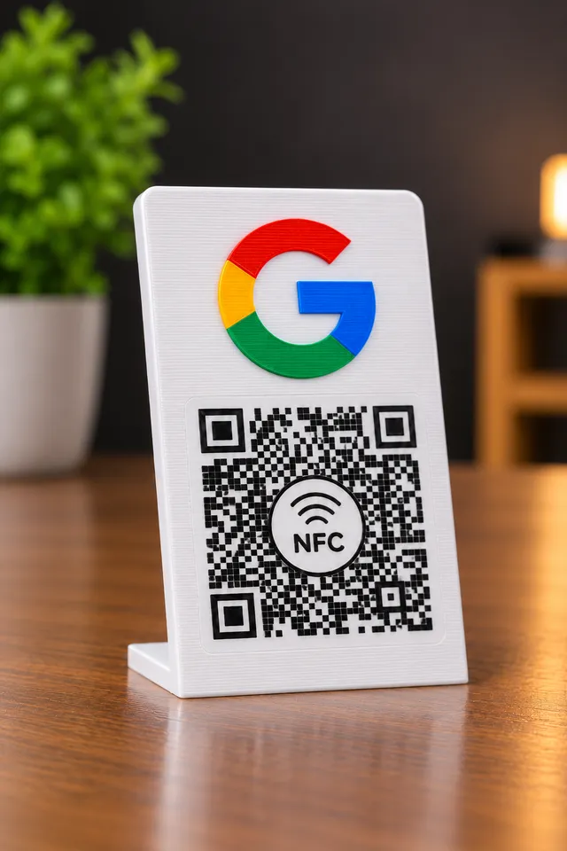
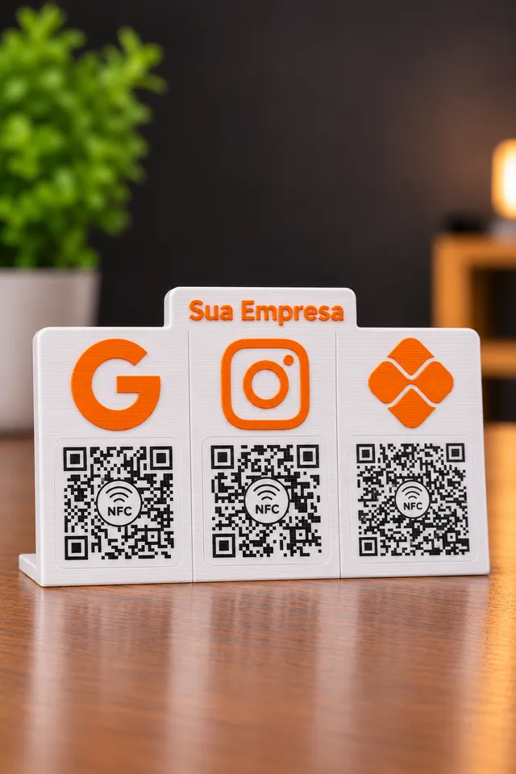
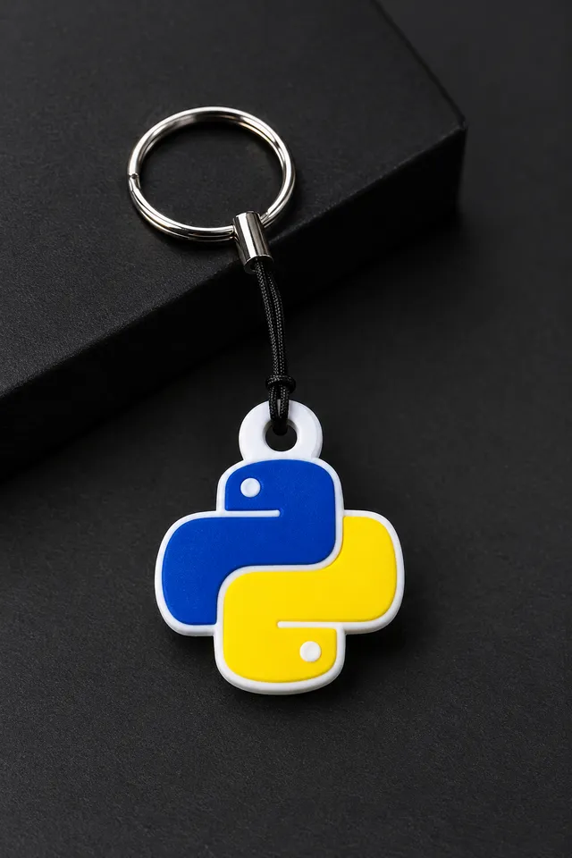
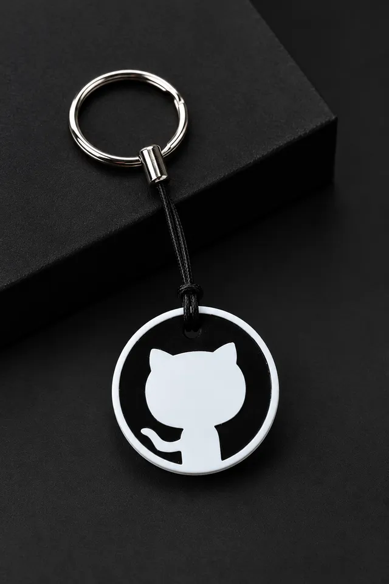

<div align="center">



<br />


### 🟣 O site oficial da **Nex7 Step**
*Sistemas, sites, plaquinhas NFC, impressão 3D e assistência técnica, tudo em um lugar só.*

</div>

---

## ✨ Sobre este documento

Este README **não é um manual de instalação**. O site é a vitrine de um negócio, não uma ferramenta para ser reaproveitada por outras pessoas. Aqui eu apenas conto **o que o site é, o que ele mostra e como ele foi pensado**.

---

## 🧭 O que é a Nex7 Step

A **Nex7 Step** é uma marca que junta **software, hardware e suporte** para ajudar negócios a darem o próximo passo. O próprio site resume a ideia em uma frase:

> **"A 7 passos do futuro."**

O número **7** é a assinatura da marca. Ele aparece no logo, no favicon, no título da página inicial e até na animação principal do site: sete degraus que sobem, com o último em destaque.

O site existe para três coisas: **apresentar a marca**, **mostrar os produtos** e **levar o visitante a pedir um orçamento**, de preferência pelo WhatsApp.

---

## 🗺️ Estrutura do site

O site tem **duas páginas**, e a navegação entre elas é simples e direta.



### 🏠 Página inicial (`index.html`)

Uma página longa dividida em seções, alternando fundo **preto** e fundo **lilás claro** para dar ritmo à leitura.

| Seção | O que o visitante encontra |
| :-- | :-- |
| **Início** | Frase de impacto, botões **"Peça um orçamento"** e **"Ver produtos"**, etiquetas dos serviços e a animação dos 7 degraus com cartões flutuantes (*Sistemas*, *NFC*, *Impressão 3D*). |
| **Quem somos** | A apresentação da marca e os **três pilares**: Software, Hardware e Suporte. |
| **Serviços** | Quatro frentes de trabalho em formato de lista: sistemas sob medida, sites e landing pages, assistência técnica e soluções inteligentes. |
| **Projetos** | Vitrine com três cartões que imitam janelas de navegador, pensada para mostrar sites, landing pages e sistemas entregues. |
| **Produtos** | Prévia com três cartões (plaquinhas, chaveiros e impressão 3D sob encomenda) que levam à página de produtos. |
| **Contato** | Dois WhatsApps, e-mail, Instagram e um **formulário que monta a mensagem pronta** para enviar por WhatsApp ou e-mail. |

### 🛍️ Página de produtos (`produtos.html`)

É o catálogo da marca, com **14 itens** em uma grade de fotos.

<table>
  <tr>
    <td align="center" width="25%"><br /><sub><b>Plaquinha Google</b></sub></td>
    <td align="center" width="25%"><br /><sub><b>Placa 3 em 1</b></sub></td>
    <td align="center" width="25%"><br /><sub><b>Chaveiro Python</b></sub></td>
    <td align="center" width="25%"><br /><sub><b>Chaveiro GitHub</b></sub></td>
  </tr>
</table>

**🔹 Plaquinhas NFC e QR Code (7)**
Google, Pix, Instagram, WhatsApp, Wi-Fi (em PETG), cardápio e a **Placa 3 em 1**, em que o cliente escolhe as três funções que quer em uma única peça. O cliente aproxima o celular ou lê o QR Code e chega direto ao destino.

**🔹 Chaveiros de programador (7)**
Java, código, GitHub, Python, JavaScript, C# e VS Code, todos em impressão 3D.

**O que dá para fazer na página:**

- 🔎 **Filtrar** por *Todos*, *Plaquinhas* ou *Chaveiros*
- 🖼️ **Ampliar** qualquer foto em uma janela de visualização, com setas para navegar entre os produtos
- 💬 **Pedir pelo WhatsApp** em cada produto: a conversa abre já com o nome do item na mensagem
- 🎨 **Pedir algo personalizado**, com a sua marca, cores e ideia

---

## 🎨 Identidade visual

O visual é **escuro, tecnológico e roxo**, com letras itálicas e inclinadas que passam sensação de movimento, como quem está subindo uma escada.

| Elemento | Escolha |
| :-- | :-- |
| **Cor principal** |  `#6b1fad` (roxo) |
| **Cor de apoio** |  `#b680e6` (lilás) |
| **Fundo claro** |  `#f4eefa` |
| **Fundo escuro** |  `#000000` |
| **Títulos** | **Orbitron**, em itálico e peso forte, com ar futurista |
| **Textos** | **DM Sans**, limpa e fácil de ler |
| **Formato dos botões** | Pílulas arredondadas |

---

## 🎬 Movimento e interação

As animações são **discretas**, feitas para dar vida ao site sem atrapalhar a leitura:

- 🪜 **Os 7 degraus** do início sobem um por vez, e o último brilha mais que os outros
- 🫧 **Cartões flutuantes** e um brilho roxo que se move suavemente atrás do título
- 👀 **Revelação ao rolar:** os blocos aparecem aos poucos conforme a pessoa desce a página
- 🌈 **Linha colorida** que desliza no topo do rodapé
- 🖱️ **Cartões que sobem** quando o mouse passa por cima, com sombra roxa
- 🧾 **Cabeçalho fixo** que ganha uma sombra assim que a página começa a rolar

---

## 📱 Pensado para qualquer tela

- O menu vira um **botão de hambúrguer** em telas pequenas
- As grades de cartões se reorganizam em uma única coluna no celular
- Em telas de toque, o ícone de ampliar das fotos fica sempre visível
- As imagens dos produtos carregam **sob demanda** (*lazy loading*), o que deixa a página mais leve

### ♿ Acessibilidade

O site tem cuidados que muita página deixa passar:

- Rótulos descritivos em links, botões e imagens
- Estado dos botões e do menu informado a leitores de tela
- Destaque visível ao navegar pelo teclado
- A janela de fotos funciona com o teclado (`Esc` fecha, `←` e `→` navegam) e devolve o foco ao ponto de onde saiu
- Quem prefere **menos movimento** no sistema recebe o site sem animações

---

## 📞 Como o cliente chega até você

Todo o site é desenhado em torno de um objetivo: **transformar visita em conversa**.

```text
 Visitante ──▶ vê o site ──▶ escolhe um produto ou preenche o formulário
                                        │
                      ┌─────────────────┴─────────────────┐
                      ▼                                   ▼
               💬 WhatsApp                           ✉️ E-mail
        (mensagem já montada)                 (assunto e texto prontos)
```

| Canal | Contato |
| :-- | :-- |
| 💬 **WhatsApp** | (34) 98838-7442 · (34) 99762-5702 |
| ✉️ **E-mail** | contato.nex7step@gmail.com |
| 📸 **Instagram** | [@nex7step](https://instagram.com/nex7step) |

---

## 🧱 Como o site é feito

É um site **estático e enxuto**, sem framework e sem etapa de build. Tudo roda direto no navegador.

```text
nex7step/
├── index.html        → página inicial
├── produtos.html     → catálogo de produtos
├── css/
│   └── style.css     → todo o visual e as animações
├── js/
│   └── main.js       → menu, rolagem, revelação e formulário
└── assets/           → logo e 14 fotos de produtos (.webp)
```

- 📦 O site inteiro pesa **cerca de 630 KB**, quase tudo em imagens
- 🔤 A única dependência externa são as **fontes do Google** (Orbitron e DM Sans)
- 🗂️ A lista de produtos é montada por script a partir de uma lista simples, então **adicionar um produto novo é só incluir uma linha**
- 🔍 Cada página tem título e descrição próprios para buscadores, e a cor do navegador no celular combina com a marca

---

## 🚧 Estado atual

O site já tem a **estrutura principal pronta**, com página inicial e catálogo completos. Um ponto ainda aguarda conteúdo:

- **Projetos:** os três cartões da seção ainda usam nomes e links de exemplo (*"Nome do site"*, *"Nome da landing page"*, *"Nome do sistema"*). Quando os projetos reais forem inseridos, essa seção passa a ser a melhor prova de trabalho da marca.

---

<div align="center">

**Nex7 Step** · *Tecnologia, impressão 3D e suporte*

Feito por **Matheus D'Ávila** · © 2026

<sub>A 7 passos do futuro. 🟣</sub>

</div>
